<p align="center">
  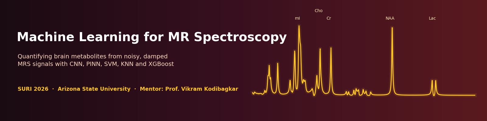
</p>

<p align="center">
  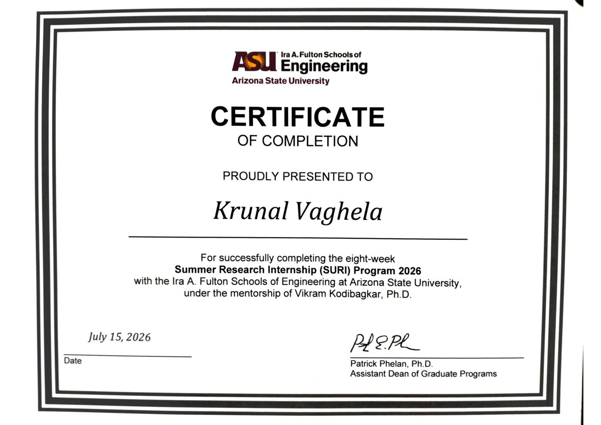
  <br><sub><i>Certificate of completion: Summer Research Internship (SURI) 2026, Ira A. Fulton Schools of Engineering, Arizona State University, under the mentorship of Prof. Vikram Kodibagkar.</i></sub>
</p>

<p align="center">
  
  
  
  
  <a href="poster/suri_poster.pdf"></a>
</p>

> **TL;DR.** **Magnetic Resonance Spectroscopy (MRS)** measures the chemical makeup of tissue without surgery. It shows how much of each brain metabolite (NAA, creatine, choline, lactate, myo-inositol) is present. Turning a measured MRS signal into those amounts is hard: the peaks overlap, the signal is noisy, and the scanner adds damping and frequency/phase shifts. During an 8-week onsite internship in **Prof. Vikram Kodibagkar's MR imaging lab at Arizona State University**, I corrected the simulated basis set and **benchmarked six machine-learning quantifiers** (unsupervised ConvNet, supervised CNN and physics-informed PINN, SVM, KNN, XGBoost) on thousands of simulated spectra.

### Key findings

| | |
|---|---|
| 🧠 **Noisy signals** | Deep learning (**CNN and PINN**) is the most robust at low-to-moderate SNR |
| 📈 **Clean signals** | **SVM** scales best with signal quality and has the lowest overall error at the highest SNR |
| 🧪 **Per metabolite** | Error depends strongly on the metabolite: choline, lactate and myo-inositol are easiest, **NAA and creatine** hardest |
| 〰️ **Line broadening** | More damping hurts NAA and creatine most; the **CNN** stays the most stable across damping levels |

### Why it matters

With **MR spectroscopic imaging (MRSI)**, a spectrum is recorded at every location in the brain, and each one has to be quantified. That turns thousands of spectra into **metabolite maps**, so the quantifier has to be both accurate and fast.

Follow the white circle in the animation. As it moves from the frontal cortex through white matter, the thalamus, a ventricle and out to the occipital cortex, the spectrum on the right and its numbers change:
- **creatine (tCr)** is higher in grey matter, so the cortex and thalamus are warmer in its map
- **choline (tCho)** is higher in white matter
- **NAA** is spread fairly evenly through brain tissue
- **in the ventricle** (fluid) all three peaks almost vanish, which is why the ventricles show up blue

Clinicians look for regions that break these normal patterns. In a tumour, for example, NAA drops and choline rises.

<p align="center">
  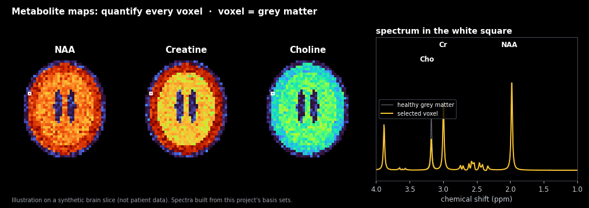
  <br><sub><i>Simulated MRSI on one axial slice (z = +16 mm) of the MNI152 standard brain, not patient data. Each location's concentrations come from its grey-matter / white-matter / fluid mix with literature values, blurred to a realistic ~7 mm resolution. The spectrum is built from this project's basis sets.</i></sub>
</p>

---

## 1 · The problem

An MRS measurement is a sum of the "fingerprint" spectra of each metabolite (the **basis set**), each scaled by how much of it is present, then distorted by the scanner:

```math
S(t) = \Big(\sum_{m} A_m\,X_m(t) + A_b\,B(t)\Big)\; e^{(\Delta\alpha + 2\pi i\,\Delta f)\,t}\; e^{i\Delta\theta} + \text{noise}
```

The unknowns are the amounts *Aₘ* (what we want), plus the damping *Δα*, frequency shift *Δf* and phase *Δθ*. The animation builds this signal from the real basis set, then adds each distortion one at a time:

<p align="center">
  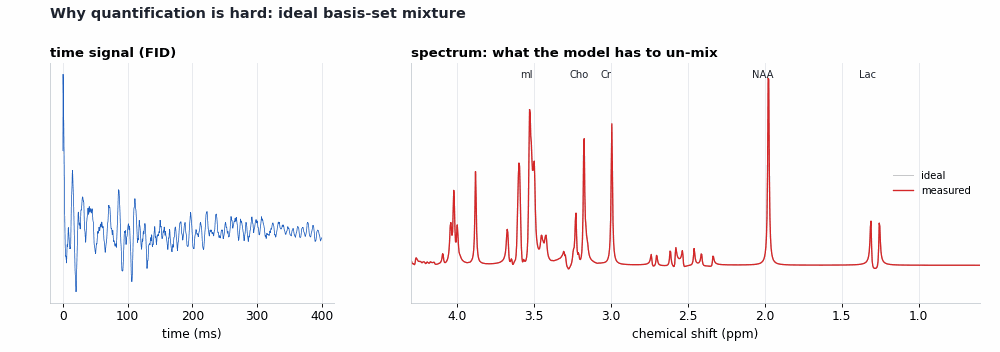
</p>

## 2 · Correcting the basis set

Every proton contributes the same amount of signal, so a metabolite's peak area divided by its number of protons should be the same for every metabolite. For the simulated basis set it wasn't: **lactate and myo-inositol came out 4–5× too small**. The cause was the T2 relaxation weighting at the 100 ms echo time (signal ∝ *A · e^(−TE/T2)*).

I measured the area of every dominant peak, divided by its proton count ([`basis_set_analysis/`](basis_set_analysis)), and rescaled the two outliers by **× 4.108 (lactate)** and **× 5.400 (myo-inositol)**:

<p align="center">
  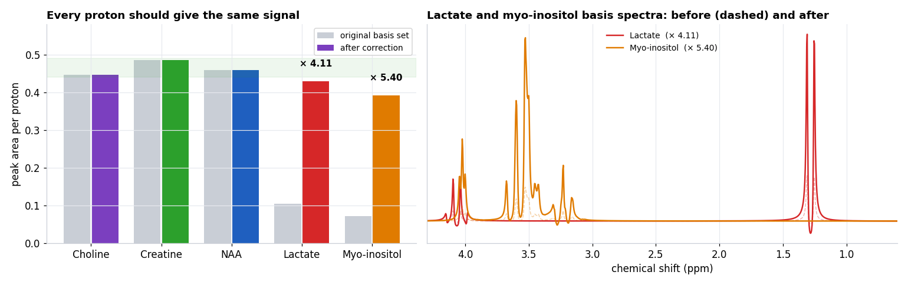
</p>

## 3 · Models compared

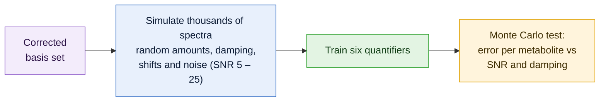

| Model | Type | Idea |
|---|---|---|
| **ConvNet** | unsupervised | encoder predicts the amounts and distortions; a physics decoder rebuilds the spectrum and the network learns by matching it ([Shamaei et al.](https://www.biorxiv.org/content/10.1101/2022.10.13.512064v1)) |
| **CNN** | supervised | 1-D convolutional network trained directly on true amounts |
| **PINN** | supervised + physics | CNN whose loss also rebuilds the spectrum from the predicted parameters |
| **SVM** | classical ML | support-vector regression on the spectrum |
| **KNN** | classical ML | average of the most similar training spectra |
| **XGBoost** | classical ML | gradient-boosted decision trees |

## 4 · Results

**Error vs signal quality.** Mean relative error over the five metabolites, from the Monte Carlo test:

<p align="center">
  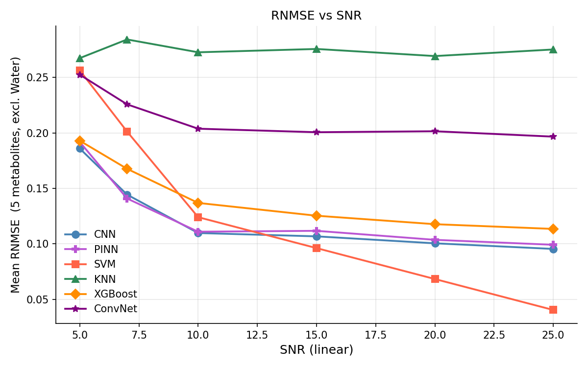
</p>

**Error per metabolite vs damping** (SNR = 15):

<p align="center">
  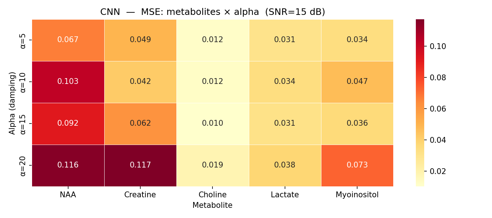
</p>

<details>
<summary><b>SVM, XGBoost and ConvNet heat maps</b></summary>

<p align="center">
  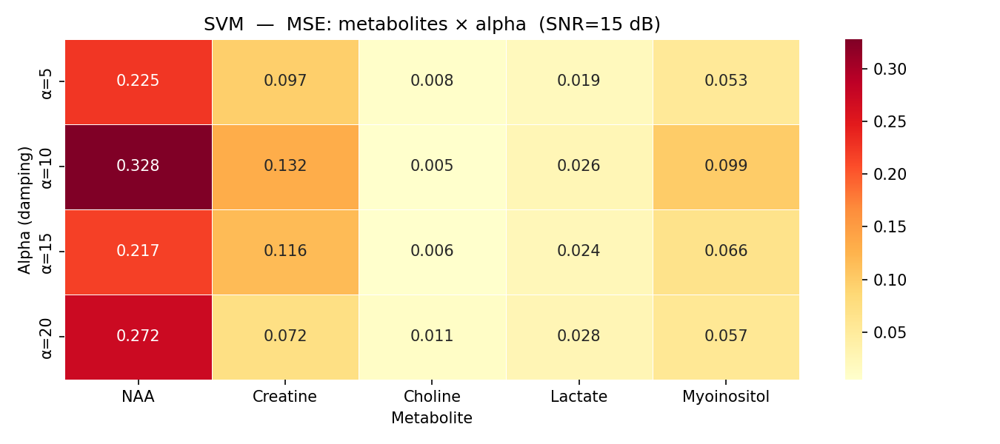<br>
  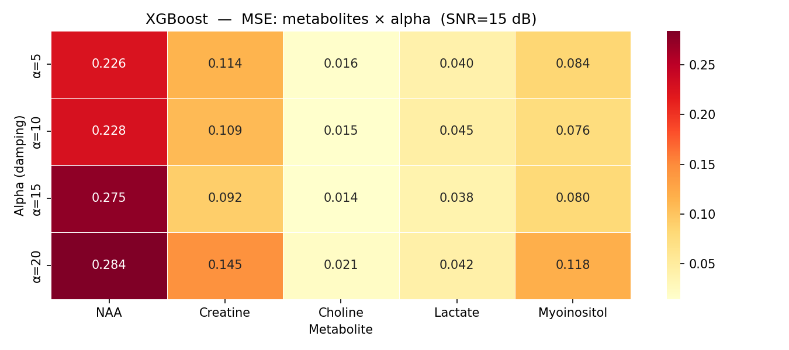<br>
  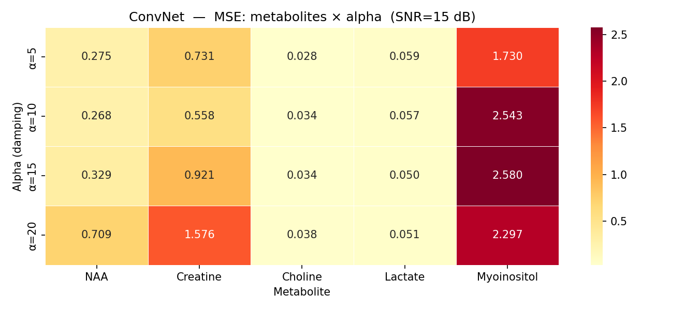
</p>

</details>

**Example fit.** A noisy input spectrum (top), the CNN's reconstruction (middle) and the overlay (bottom):

<p align="center">
  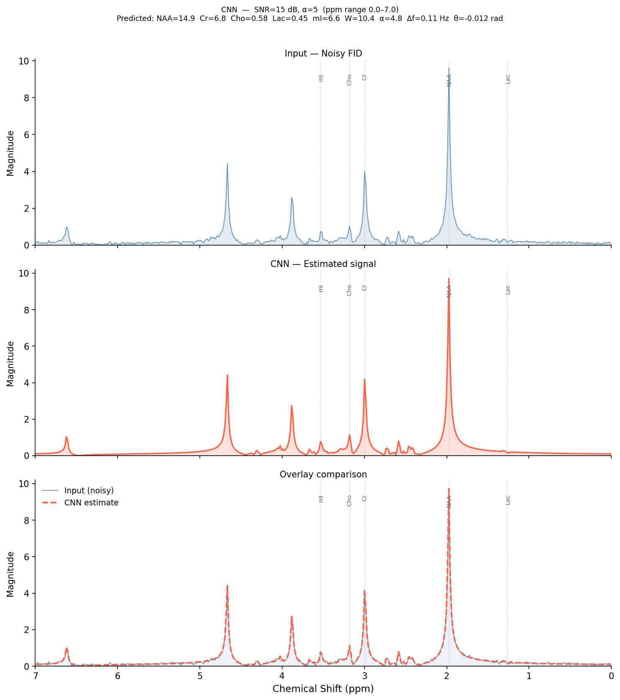
</p>

### Limitations and next steps

- The models were tested on **simulated** spectra. Real in-vivo data also has baseline distortions and macromolecule signals.
- Cleanly resolved metabolites like choline look easy for every model, which can hide how hard the overlapping, low-concentration ones are.
- Next: add denoising before quantification, and train on spectra that include realistic artifacts.

## 5 · Poster

<p align="center">
  <a href="poster/suri_poster.pdf">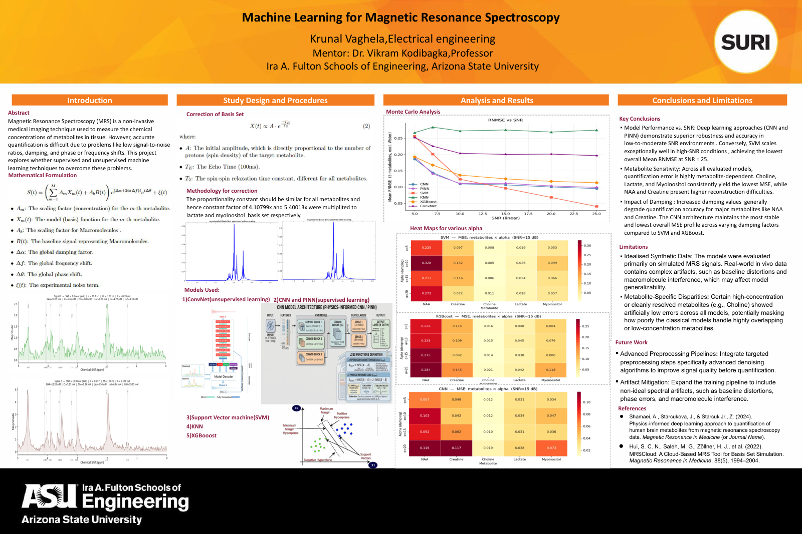</a>
  <br><sub>Click for the full-resolution PDF.</sub>
</p>

---

## Repository

> [!NOTE]
> **About the code.** Most of this project's codebase, including the data simulation and the training and evaluation of all six models, is stored on **ASU's supercomputer**, where the experiments were run. I no longer have access to it, so this repository contains the **results I had saved on my own machine** (metrics, plots, heat maps and the poster), together with my **MATLAB basis-set analysis**. The training pipeline is described step by step in [`docs/pipeline.md`](docs/pipeline.md).

```
basis_set_analysis/   MATLAB: per-peak area / per-proton analysis, rescaling and plots (+ the basis sets they read)
results/basis_set/    tables produced by the basis-set analysis
results/ml_benchmark/ Monte Carlo benchmark: metrics (CSV), RNMSE-vs-SNR curve, heat maps, example fits
poster/               SURI poster (PDF + PNG)
docs/                 training pipeline notes, figures, and the script that generates them
```

<details open>
<summary><b>What every file does</b></summary>

| File | What it does |
|---|---|
| **`basis_set_analysis/`** | |
| `per_peak_area_table.m` | measures the area of every peak/multiplet in each basis spectrum and divides by its proton count |
| `per_peak_area_with_rescaling.m` | same analysis, then rescales metabolites towards a target area-per-proton ratio |
| `full_basis_set_analysis_with_plots.m` | full-spectrum + per-peak analysis in one table, with a plot of every peak window |
| `dual_pass_rescaling_analysis.m` | runs the analysis before and after rescaling the FIDs (baseline vs corrected) |
| `plot_rescaled_spectra.m` | plots lactate and myo-inositol spectra before and after correction |
| `plot_choline_basis_set.m` | FID, spectrum and decay processing for one basis-set metabolite |
| `*_1.mat`, `GE_UnEdited_PRESS_TE30_*.mat` | simulated basis sets (GE PRESS, TE 30 ms, 3 T) in FID-A format |
| **`results/basis_set/`** | |
| `dominant_peak_analysis.txt`, `PerPeak_Area_Results.csv` | area per proton for each dominant peak, the numbers behind the correction factors |
| `Consolidated_MRS_Results.csv`, `MRS_Analysis_*.csv` | full analysis tables before and after rescaling |
| **`results/ml_benchmark/`** | |
| `rnmse_vs_snr.png` | mean error vs SNR for all six models |
| `*_heatmap_alpha.png`, `*_heatmap_snr.png` | error per metabolite vs damping / SNR |
| `*_example_spectrum.png`, `signal_*_snr*.png`, `example_input_spectrum.png` | example inputs and fits |
| `mrs_model_metrics_*.csv`, `overall_metrics.csv`, `nmse_snr_bins.csv` | numeric results |
| **`docs/`** | |
| `pipeline.md` | how the training and evaluation were run on ASU's research computing cluster |
| `make_figures.py` | regenerates the README figures from the basis sets (the metabolite-map animation needs `pip install nilearn` for the MNI152 template) |

</details>

---

## Acknowledgements

This work was done during the **Summer Research Internship (SURI) 2026** at the Ira A. Fulton Schools of Engineering, Arizona State University (selected as one of 30 from 1500+ applicants), under the mentorship of **Prof. Vikram Kodibagkar**. Training ran on ASU Research Computing. Basis sets were simulated with [MRSCloud](https://doi.org/10.1002/mrm.29370). The unsupervised ConvNet baseline is from [Shamaei et al.](https://www.biorxiv.org/content/10.1101/2022.10.13.512064v1).

The metabolite-map illustration uses the ICBM 2009 MNI152 template and tissue maps (via [nilearn](https://nilearn.github.io)): Copyright (C) 1993–2009 Louis Collins, McConnell Brain Imaging Centre, Montreal Neurological Institute, McGill University.
