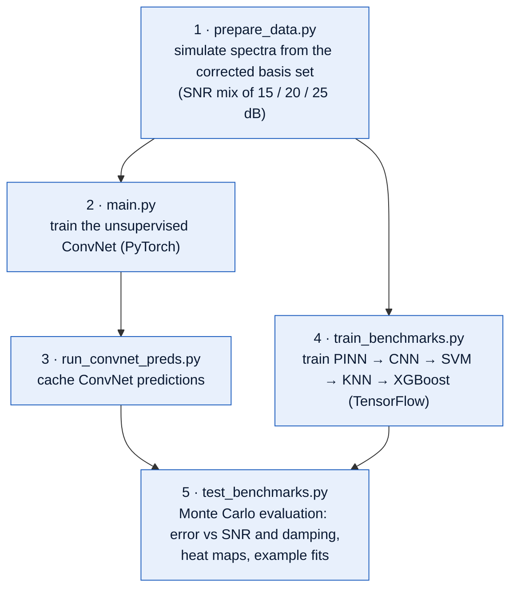

# Training and evaluation pipeline

The machine-learning benchmark was run on Arizona State University's research computing cluster, in two software environments (TensorFlow 2.15 and PyTorch 2.1, both on GPU).



```bash
# 1. Generate dataset (SNR mix 15/20/25 dB)
python prepare_data.py
# 2. Train ConvNet (PyTorch environment)
python main.py
# 3. Cache ConvNet predictions (PyTorch environment)
python run_convnet_preds.py
# 4. Train PINN -> CNN -> SVM -> KNN -> XGBoost (TensorFlow environment)
python train_benchmarks.py
# 5. Run all analyses and generate plots (TensorFlow environment)
python test_benchmarks.py
```

The outputs of step 5 are in [`results/ml_benchmark/`](../results/ml_benchmark).

## Metrics

- **NMSE**: mean squared error divided by the variance of the true amounts
- **RNMSE**: square root of NMSE, the "mean relative error" plotted against SNR
- Errors are reported per metabolite (NAA, creatine, choline, lactate, myo-inositol) and averaged over Monte Carlo trials
